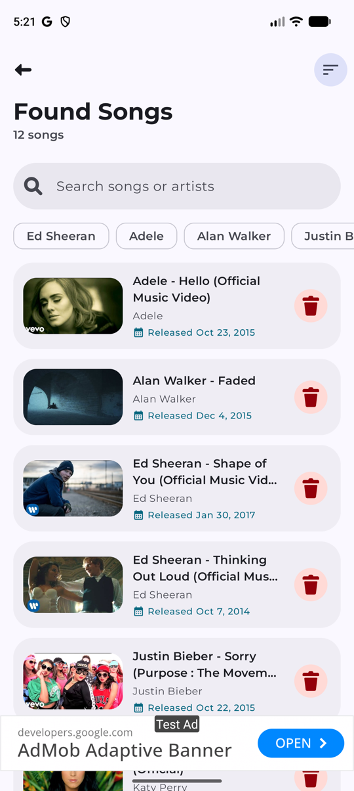
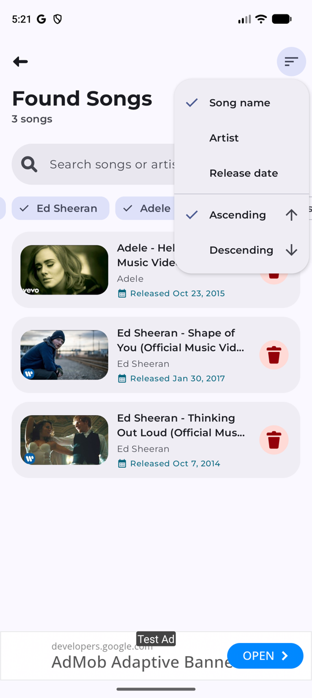
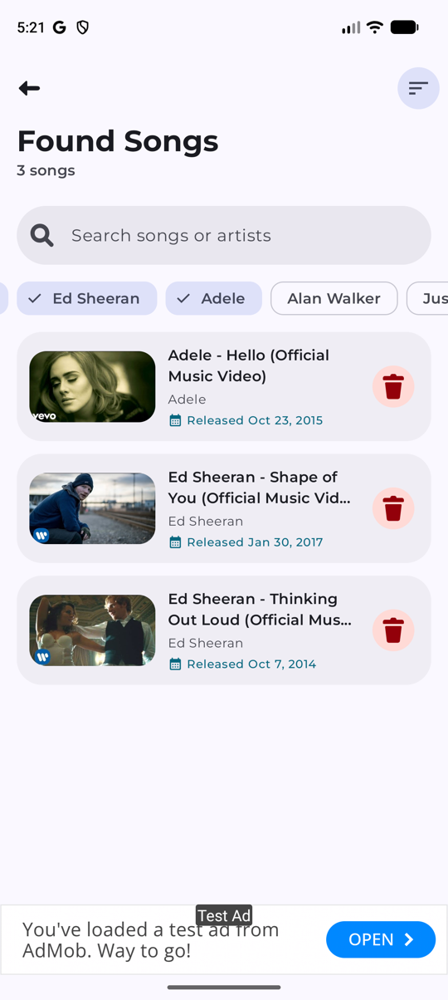
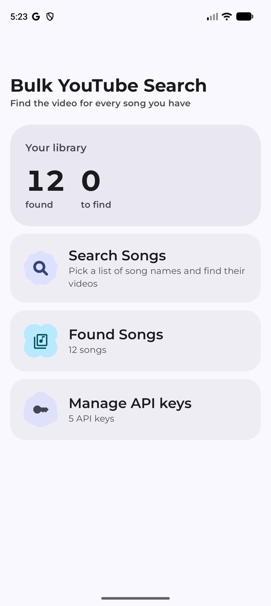

# BYS — Bulk YouTube Search

Give it a list of song names; it finds each one on YouTube in the background and keeps the
matches as a playable library. Built with Jetpack Compose and Material 3 Expressive.

| Found songs | Search, filter, sort | Player |
| --- | --- | --- |
|  |  |  |

| Artist filter | Home | Full screen |
| --- | --- | --- |
|  |  |  |

## Features

- **Bulk search**: pick a JSON list of song names (or a `video_links.json` export); a WorkManager
  job searches YouTube for each, rotating across your API keys when one runs out of quota.
- **Found songs**: search by song or artist, filter by one or more artists with chips, and sort by
  song name, artist or release date, up or down. The choices survive rotation.
- **Release dates** come from YouTube's `publishedAt`. New finds store it; songs found earlier get
  it filled in with one `videos` call per 50 songs.
- **Player**: plays in the app, shrinks to picture-in-picture, and goes full-screen landscape from
  the player's own button or the **Full screen** button below it; back returns to portrait.
- **API keys** screen to add, see and remove YouTube Data API keys.

## Build

```bash
./gradlew :app:assembleDevDebug       # debug APK
./gradlew :app:assembleProdRelease    # release APK (needs keystore and keys.json)
scripts/ci-local.sh                   # ktfmt + compile, the check before every push
```

`keys.json` (YouTube API keys) and the keystore are git-ignored and stay on your machine.

## Working on it

Coding agents read [AGENTS.md](AGENTS.md); UI rules are in
[material3-expressive](.agents/skills/material3-expressive/SKILL.md). The agent setup comes from
[Android Agent Kit](https://github.com/raghavsatyadev/Android-Agent-Kit).

Tooling: Android Studio Narwhal Feature Drop | 2025.1.2 Canary 8.
